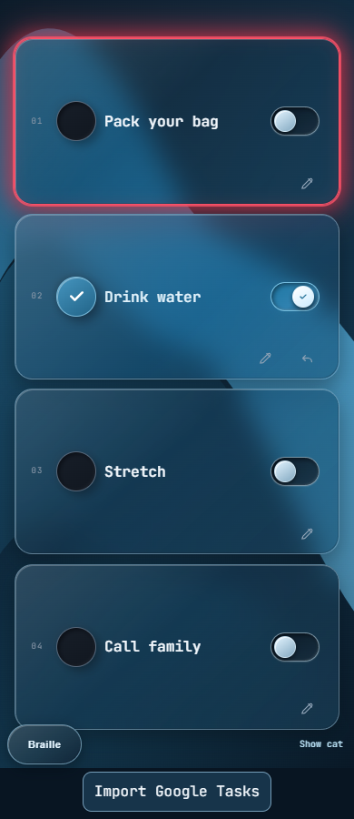

# Tactile Reminders

**Four reminders. Two dials. Two switches. A small companion to celebrate getting things done.**

Tactile Reminders is a desk switchboard concept and a working mobile web app, built for **OU SASEHacks 2026 — SASEHACKS FOR GOOD**. It gives a few important tasks a fixed place and makes completion visible, tangible and encouraging.

[Try the live demo](https://tactile-reminders-demo-2026.yvan314234.chatgpt.site/) · [Run locally](#getting-started) · [Google Tasks setup](#google-tasks-optional) · [Presentation guide](coordination/demo/JUDGING_PACKAGE.md)

## The idea

Long task lists and repeated notifications can be easy to tune out. We wanted a small, dedicated reminder board that stays on a desk, with a satisfying physical action associated with each task.

The prototype places a portrait phone on the left of a 3D-printed enclosure, with two dials and two stick switches on the right. Each control corresponds to one reminder. The phone demonstrates a future integrated display.

We are exploring this interaction for people who benefit from tactile routines, including people with ADHD and people with vision-accessibility needs. User testing and connected tactile output are future work; the prototype does not establish a clinical benefit.

**What is physical today:** a printed enclosure and mechanical controls. **What works in software:** reminders, urgency, completion/Undo, saving, companion feedback, a visual Braille mode and a configurable Google Tasks importer. The printed controls are not electronically connected; presenters openly mirror their actions in the app.

## Features

| Feature | Current behavior |
|---|---|
| Four fixed reminders | Add and edit tasks without changing their physical slot order. |
| Completion and Undo | Tap the completion circle, or swipe a simulated switch right to complete and left to undo. |
| Urgent tasks | Mark a reminder Urgent in its editor. Pending urgent tasks have a red glow; completion removes the glow and Undo restores it. Urgency survives reload. |
| Completion feedback | Brief synthesized click audio where supported, cat encouragement, and confetti. Normal tasks use blue/black/white; urgent tasks use red/black/white. |
| Pixel-art companion | A black cat roams in the portrait layout. Drag it or focus it and use arrow keys; Shift+arrows moves farther. Use Hide cat for an unobstructed view. |
| English/Braille display | Toggle displayed titles to a Unicode Braille character mapping. Stored titles, editors and accessible title labels remain English. |
| Local persistence | Task titles, urgency and completion are saved in this browser using localStorage. |
| Google Tasks import | After OAuth setup, manually import incomplete tasks due today into selected empty slots, with duplicate prevention and read-only Google access. |
| Reduced motion | The OS/browser preference stops cat movement, urgent pulsing and visible confetti. |

### Interface preview



*Browser preview at a 390 × 844 viewport, using sample data. The cat is hidden for clarity; this is not a physical-iPhone test.*

## Getting started

Use **Node.js 22.12+ or Node.js 24**, with npm.

```sh
git clone https://github.com/Jaxonize/sasehacks-ou-2026.git
cd sasehacks-ou-2026
npm ci
npm run dev -- --port 5173
```

Open **http://localhost:5173/**. For local phone testing, use Vite's printed network URL on the same Wi-Fi. The laptop must keep the server running, and its firewall/network must permit the connection.

Google configuration is optional; the reminder board works without it.

### Commands

| Command | Purpose |
|---|---|
| `npm run dev -- --port 5173` | Start the development server, including a LAN preview. |
| `npm test` | Run reminder, storage, Google API and companion transition tests. |
| `npm run build` | Type-check and create the production bundle in `dist/`. |
| `npm run preview` | Preview the production bundle locally after building. |

The app is a static Vite frontend and does not require a backend server or database.

## Usage

1. Choose **Add** in an empty row, enter a title and optionally select **Urgent**. Save the reminder.
2. Complete it by tapping the circle or swiping the right-side simulated switch **right**. A tap on the switch itself intentionally does nothing.
3. Reopen it by tapping the completed circle, choosing **Undo**, or swiping the switch **left**.
4. Use the pencil button to edit the title or urgency. **Cancel** or Escape leaves the saved task unchanged.
5. Use **Braille/English** to change the title display, and **Hide cat/Show cat** to control the companion.

Keyboard users can Tab to the completion circle and Edit/Undo buttons and activate them with Enter/Space. The swipe switches themselves are pointer/touch controls. The cat also supports arrow-key movement when focused.

New titles and editor saves are limited to **60 characters**. Existing or Google-imported titles up to **200 characters** are preserved. Editing a longer title requires explicitly shortening it; a rejected save retains the draft, and Cancel preserves the original.

Completed reminders remain assigned to their slots. There is no delete, automatic daily reset or task-reordering interface in this prototype. **Leave a slot empty if you plan to demonstrate Google import.**

### Physical mapping

| Slot, top to bottom | Enclosure control |
|---|---|
| 1 | Dial 1 |
| 2 | Dial 2 |
| 3 | Switch 1 |
| 4 | Switch 2 |

All four on-screen simulators use the same swipe interaction. The separate core `activateControl` action intended for future hardware is completion-only and idempotent: repeated activation cannot undo a task.

## Google Tasks (optional)

This integration reads **Google Tasks due today**, not Calendar events. It follows all task-list/task pages, compares Google's date-only due value with the device's local calendar date, and excludes completed, deleted and undated tasks.

### Configure your own client

1. Enable **Google Tasks API** in a Google Cloud project.
2. Configure OAuth consent, the read-only Tasks scope and any required test users.
3. Create a **Web application** OAuth client. Authorize the exact origin, such as `http://localhost:5173`; add the deployed HTTPS origin separately when using a hosted build.
4. Create ignored `.env.local` in the repository root:

```dotenv
VITE_GOOGLE_CLIENT_ID=YOUR_PUBLIC_WEB_CLIENT_ID.apps.googleusercontent.com
```

5. Restart the dev server. For production, configure the value **before** `npm run build`.
6. Open **Import Google Tasks**, choose **Connect Google Tasks**, grant read-only access, select a task and an empty slot, then import. Adjust the local title if necessary.

Plain HTTP LAN phone addresses are not supported Google web OAuth origins. Use a configured localhost origin or an authorized HTTPS hostname.

Import never silently replaces an occupied reminder. Duplicate checks use task-list ID plus task ID. Editing or completing the imported copy does **not** change Google. Access tokens stay in memory and are cleared by reload or **Clear connection**; that button does not revoke Google-side authorization. Never place a client secret or token in source.

See the [integration guide](src/integrations/google/README.md) for scope, pagination, error handling and full setup instructions.

## Architecture and data

```text
src/
  core/                  Reminder actions, validation, persistence and tests
  ui/                    Portrait layout, gestures, urgency, Braille mapping and effects
  companion/             Cat component and completion-transition detection
  integrations/google/   OAuth token flow, read-only API adapter and import dialog
  App.tsx                Shared state and component integration
assets/companion/        Cat artwork and generation provenance
scripts/                 Source-archive handoff helper
```

Built with **React, TypeScript and Vite**, browser **localStorage**, **Pointer Events**, **Web Audio**, **Google Identity Services** and the **Google Tasks API**. JetBrains Mono is bundled locally.

Reminders belong to the current browser, device and origin. A laptop localhost import does not populate the phone or public demo. Same-origin tabs refresh from storage and sequential actions rebase before saving; simultaneous writes are not transactional. When saving is unavailable, the app warns that changes may remain only in the current tab.

## Prototype limits and verification

- Physical controls are simulated; there is no electronic hardware connection or refreshable Braille output.
- Braille mode is a visual character mapping, not a validated Braille translator. It is not a substitute for tactile output or screen-reader/user testing.
- The cat can overlap task content; hide or reposition it when needed. Keyboard completion is available through the circle/Undo controls rather than the swipe switch.
- Audio depends on browser support and playback permission. Braille display and cat visibility reset on reload; reduced motion follows the system/browser preference.
- There is no cross-device sync, account backend, recurring schedule or reminder notification service.

The V30 source audit passed **21 automated tests**, TypeScript checking and the production build. Browser checks covered urgency/reload, completion/Undo/swipes, English accessible titles in Braille mode, legacy-title preservation, Google setup messaging, reduced motion and layouts at 390×844, 375×812 and 419×604. The public demo loads and its Google sign-in SDK becomes ready; **a real account consent/import, physical iPhone keyboard/audio and screen-reader speech were not exercised in this audit**.

See the [final audit](coordination/updates/2026-10-24-1634-codex-final-readme-audit.md) for evidence, remaining issues and presentation guidance.

## Credits and event context

Built during **OU SASEHacks on October 24, 2026**, under the theme **SASEHACKS FOR GOOD**. The black cat was generated during the event; [artwork prompts and provenance](assets/companion/README.md) are included. Third-party packages and the bundled font retain their respective licenses; this repository does not currently declare a project-wide license.

Contributors: read [AGENTS.md](AGENTS.md), [TEAM_COORDINATION.md](TEAM_COORDINATION.md), [HANDOFF.md](HANDOFF.md) and the latest [updates](coordination/updates/) before editing. The [judging package](coordination/demo/JUDGING_PACKAGE.md) contains pitch and walkthrough drafts.

Official submission: [OU SASEHacks Devpost](https://ou-sasehacks.devpost.com/). Be ready with a presentation at **5:15 p.m. CDT in Gallogly Hall, Room 127**. **Final Devpost submission remains on hold until Jaxon explicitly authorizes it.** Source publication does not release that hold.

## Hosted demo

Use the [Netlify demo](https://clever-puffpuff-2265f2.netlify.app/) on phones. The [existing HTTPS demo](https://tactile-reminders-demo-2026.yvan314234.chatgpt.site/) is also available. Both currently host integrated V30; deployment is manual, so a GitHub push alone does not update them.

Both HTTPS addresses are registered as Google OAuth JavaScript origins. Google sign-in is still in Testing mode and requires an approved test account; successful live import remains to be confirmed. See the [deployment and OAuth checkpoint](coordination/updates/2026-10-24-google-https-setup.md).
